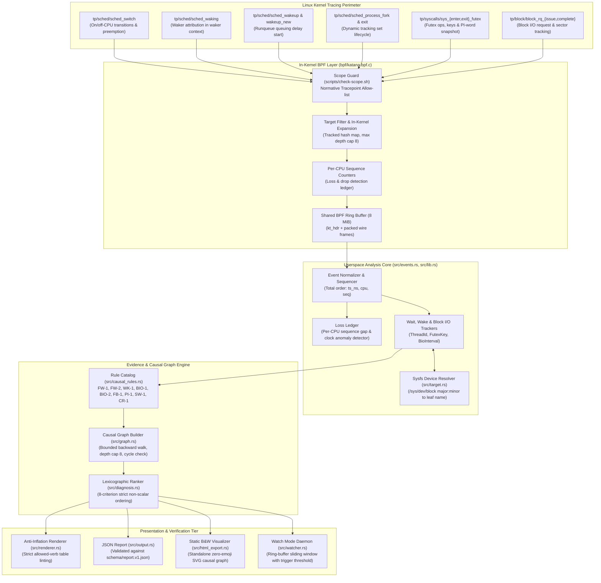

<a id="readme-top"></a>

<!-- PROJECT HEADER -->
<br />
<div align="center">
  

  <h1 align="center">katana</h1>

  <p align="center">
    <strong>Deterministic Latency Root-Cause Analysis for Linux</strong>
    <br />
    Kernel Tracepoints &middot; Bounded eBPF Ring Buffers &middot; Evidence-Explicit Causal Graph &middot; Lexicographic Diagnosis Ranker &middot; Anti-Inflation Language Discipline
    <br />
    <br />
    <a href="docs/ARCHITECTURE.md"><strong>System Architecture</strong></a>
    &middot;
    <a href="docs/EVIDENCE_MODEL.md"><strong>Evidence Model</strong></a>
    &middot;
    <a href="docs/TESTING.md"><strong>Testing Guide</strong></a>
    &middot;
    <a href="docs/DEVELOPMENT.md"><strong>Development Runbook</strong></a>
    &middot;
    <a href="docs/adr/README.md"><strong>Architecture Decision Records</strong></a>
    &middot;
    <a href="prd.md"><strong>Technical PRD</strong></a>
    &middot;
    <a href="https://github.com/Atharva-Mendhulkar/katana/issues">Report an Issue</a>
  </p>
</div>

---

## Overview

**Katana** is a single-host, bounded-cost diagnostic engine engineered to determine why a thread or process on Linux stopped making progress. Rather than aggregating high-level CPU metrics, presenting opaque statistical percentiles, or emitting ungrounded heuristic guesses, Katana reconstructs explicit causal dependency chains from low-overhead kernel tracepoint events (`sched:sched_switch`, `sched:sched_waking`, `syscalls:sys_enter/exit_futex`, `block:block_rq_issue`, and `block:block_rq_complete`).

When a critical thread stalls, Katana answers four fundamental systems questions:
1. **Was the thread actually blocked?** Identifies thread wait states, off-CPU intervals, and runqueue queueing delays with microsecond precision.
2. **Who released it?** Attributes wakeups to specific waker threads using kernel interval containment and syscall return validation.
3. **What was the causal dependency chain?** Walks backward through chains of sleeping and waking threads up to a bounded depth of 8 hops, isolating root wakers and detecting cyclic wake dependencies.
4. **Is the finding causal or merely correlated?** Enforces strict mathematical and semantic segregation between proven causal mechanisms and contextual background signals (such as CPU saturation or PSI pressure).

### Prior Art & Positioning

Katana builds directly on established foundations in systems and kernel tracing research:
- **Prism (Landau, Barbosa, Saurabh; IPDPS 2026):** Thread dependency tracking and wait-graph modeling. Katana adopts Prism's selective thread-tracking paradigm, focusing it into a lightweight, one-shot diagnostic tool.
- **BCC `offwaketime` / `perf sched` (Gregg, ~2015–16):** Off-CPU analysis and `sched_waking` attribution. Katana replaces ambiguous folded stack aggregations with structured, evidence-typed causal narratives.
- **Linux Kernel eBPF Infrastructure:** In-kernel ring buffers (`BPF_MAP_TYPE_RINGBUF`), BPF Type Format (CO-RE / BTF), and tracepoints.

---

## Target System Architecture

The Katana engine operates as a deterministic pipeline that transforms kernel events into verified root-cause diagnoses:



---

## Core Architectural Pillars

### 1. Zero-Daemon Bounded Overhead & Post-Incident Precision
- Designed for single-command, bounded-overhead execution (`katana explain <PID>`) without persistent background daemons.
- Employs an in-kernel single shared ring buffer (8 MiB default) with per-CPU sequence numbers.
- Hot-path tracepoint programs early-exit with a single hash lookup for non-tracked tasks, avoiding system-wide performance degradation.

### 2. Strict In-Kernel Dependency Expansion & Hook Allow-List
- Dynamically tracks target process threads and selectively expands tracking only to verified wakers (`WAKING` hook) up to a bounded depth cap (8 hops).
- Strictly verified by [`scripts/check-scope.sh`](scripts/check-scope.sh) against normative allow-lists per PRD §4, §8.2, and §32.1. Kprobes, fentry on internal functions, and unvetted probe attachments are strictly forbidden.

### 3. Rule FW-1: Deterministic Futex Wake Causal Attribution
- Attributes `T2 ->wakes-> T1 via futex A` if and only if:
  1. `E3` (`sys_enter_futex`) and `E5` (`sys_exit_futex`) enclose a wake syscall on TID `T2`.
  2. `E4` (`sched_waking`, waker `T2`, wakee `T1`) satisfies `ts(E3) - ε <= ts(E4) <= ts(E5) + ε` (where `ε = 50 µs`) and `seq(E3) < seq(E4) < seq(E5)` on the same CPU.
  3. `T1` has an open `FutexWait` or `PiWait` interval at `ts(E4)`.
  4. Matching futex key: `tgid(T1) == tgid(T2)` and `uaddr(T1) == uaddr(T2)` (for private futexes) with non-zero bitset intersection.
- Validates syscall return value (`ret`). If `wakes_observed > ret`, flags `INCONSISTENT_WAKE_COUNT` contradiction, downgrades findings, and marks completeness as `AMBIGUOUS`.

### 4. Rule BIO-1 & BIO-2: Synchronous Direct I/O vs. Writeback Clamping
- **Rule BIO-1:** Direct synchronous block I/O (`O_DIRECT`, `fsync`) is causally attributed if the submitter context matches the wakee, the device request matches completion, and timestamps enclose the block interval.
- **Rule BIO-2:** Structural clamp for asynchronous writeback (`kworker` / flushing threads). Strictly classified as `CORRELATED / STATISTICAL` with the mandatory disclaimer: *"This trace does not establish a causal link."*
- Resolves device major:minor numbers to human-readable names (`nvme0n1`, `sda1`) via `/sys/dev/block/`.

### 5. Multi-Hop Backward Chain Reconstruction & Cycle Detection
- Walks backward from the subject's longest blocked interval along causal `WokenBy` and `BlockedOnBio` edges.
- Resolves each hop to a terminal reason: `WakerRunning`, `WakerIrq`, `HistoryBeforeTracking`, `Timeout`, or `Interrupted`.
- Detects loops in wake dependencies, emitting `"observed wake cycle within window"` rather than hallucinating deadlocks.

### 6. 8-Criterion Lexicographic Ranking Engine
- Eliminates subjective weighted formulas or arbitrary scoring scalars. Candidate diagnoses are evaluated along a strict 8-tier lexicographic ordering:
  1. **Subject Relevance:** Direct block (1) vs. indirect block (0).
  2. **Causal Basis:** Contains &ge;1 `CAUSAL` edge (1) vs. only `OBSERVED`/`CORRELATED` (0).
  3. **Explained Fraction:** Integer per-mille of blocked duration accounted for.
  4. **Weakest-Link Strength:** `Strong` > `Moderate` > `Weak`.
  5. **Completeness:** `Complete` > `Partial` > `Lossy` > `Invalid`.
  6. **Chain Compactness:** Shorter chain depth preferred.
  7. **Repetition:** Total occurrence count.
  8. **Tie-Breaker:** Lowest start timestamp, lowest thread ID.

### 7. Anti-Inflation Language Discipline & Allowed-Verb Grammar
- Structurally prevents claim inflation in generated diagnostics:
  - `CAUSAL / DIRECT`: `"was woken by"`, `"was preempted by"`.
  - `CAUSAL / DERIVED`: `"was released by a futex wake from"`.
  - `OBSERVED`: `"was blocked for"`, `"entered ... wait on"`.
  - `CORRELATED`: `"coincided with"`, `"overlapped with"` (mandates suffix: `"This trace does not establish a causal link."`).
- Enforced at compile time and verified by dedicated anti-inflation test suites.

### 8. Static Zero-Emoji HTML Visualization & Continuous Watch Mode
- **Zero-Dependency SVG Causal Graph:** Single standalone HTML file export (`--html <path>`) with clean high-contrast black/white styling, strict SVG topology layouts, and zero external network calls or web fonts.
- **Continuous Watch Mode:** In-memory ring buffer (`--watch --threshold 500ms`) that monitors running targets and automatically snapshots and triggers causal explanations only when blocking exceeds defined latency thresholds.

---

## Monorepo Directory Structure

```
katana/
├── benchmarks/                       # Microbenchmark harnesses & evaluation data
│   ├── bench_main.rs                 # Synthetic NVMe multi-drive latency & throughput benchmark
│   ├── results_nvme_multidrive.csv   # Empirical NVMe PCIe throughput & percentile CSV
│   └── results_phase2.csv            # Phase 2 baseline disk I/O benchmarks
├── bpf/                              # In-kernel C eBPF programs & headers
│   ├── katana.h                      # Shared wire format structs, event types & ABI constants
│   └── katana.bpf.c                  # eBPF tracepoint probes, tracking map & ringbuf
├── docs/                             # Engineering specifications & dossiers
│   ├── adr/                          # Architecture Decision Records (ADR-0001 through 0015)
│   ├── ARCHITECTURE.md               # Detailed end-to-end system architecture
│   ├── DEVELOPMENT.md                # Development runbook, toolchain & building instructions
│   ├── EVIDENCE_MODEL.md             # Formal 4-tier evidence classification & monotonic clamp
│   ├── KERNEL_COMPATIBILITY.md       # Linux kernel 5.15+ compatibility matrix
│   ├── LIMITATIONS.md                # Normative operational boundaries & constraints
│   ├── PHASE1_MVP.md                 # Phase 1 MVP technical architecture dossier
│   ├── PHASE2_LOG.md                 # Phase 2 block I/O & OTQ implementation review
│   ├── PHASE3_LOG.md                 # Phase 3 HTML export & watch mode development log
│   └── TESTING.md                    # Comprehensive test strategy & execution guide
├── fixtures/                         # Deterministic synthetic replay traces
│   ├── bio1_sync_io.json             # Synchronous direct NVMe read trace
│   ├── bio2_writeback.json           # Asynchronous kworker writeback trace
│   └── contention.json               # Multi-waiter futex contention trace
├── schema/                           # Machine-readable output schemas
│   └── report.v1.json                # JSON Schema draft-07 diagnosis report specification
├── scripts/                          # CI verification & environment scripts
│   └── check-scope.sh                # Normative eBPF hook allow-list validator
├── src/                              # Userspace Rust analysis engine & CLI
│   ├── block_io.rs                   # Block I/O interval tracking, BIO-1 & BIO-2 rules
│   ├── causal_rules.rs               # Causal rules (FW-1, WK-1, SW-1, CR-1)
│   ├── cli.rs                        # CLI argument parsing, flags & exit codes
│   ├── diagnosis.rs                  # 8-criterion lexicographic ranking engine
│   ├── events.rs                     # Binary wire decoder, normalizer & loss ledger
│   ├── evidence.rs                   # Typed evidence model & monotonicity clamp
│   ├── futex.rs                      # Futex op decoding, keys & interval trackers
│   ├── graph.rs                      # Causal graph builder & backward chain walker
│   ├── html_export.rs                # Static black-and-white standalone SVG HTML exporter
│   ├── lib.rs                        # Engine coordinator & pipeline orchestration
│   ├── main.rs                       # Binary entry point & exit code management
│   ├── output.rs                     # JSON report serialization & target identity
│   ├── renderer.rs                   # Anti-inflation narrative template renderer
│   ├── scheduler.rs                  # Scheduler states, thread IDs & provenance refs
│   ├── target.rs                     # Target /proc identity & sysfs device resolver
│   └── watcher.rs                    # Continuous ring-buffer sliding window watcher
├── tests/                            # Automated behavioral verification suites
│   ├── anti_inflation_tests.rs       # Static max-class invariants & banned verb linting
│   ├── block_io_tests.rs             # BIO-1, BIO-2, sysfs resolution & wire tests
│   ├── fault_injection_tests.rs      # Robustness, cycle detection & loss injection
│   ├── fw1_tests.rs                  # Rule FW-1 pairing & cross-CPU attribution suite
│   └── phase3_features_tests.rs      # HTML report validation & watch mode capacity tests
├── Cargo.toml                        # Cargo configuration & dependencies
├── logo.png                          # Katana logo artwork
└── prd.md                            # Complete Katana Technical PRD
```

---

## Verification & Testing Matrix

Every rule, invariant, and failure mode is continuously verified by automated test suites with **100% pass rates**:

```
┌────────────────────────────────────────────────────────────────────────────────────────┐
│                                 AUTOMATED TEST MATRIX                                  │
├──────────────────────────────┬────────────────────────────┬─────────────┬──────────────┤
│ Test Suite                   │ Target Layer               │ Tests       │ Result       │
├──────────────────────────────┼────────────────────────────┼─────────────┼──────────────┤
│ tests/anti_inflation_tests   │ Max-Class & Verb Table Lint│ 2 tests     │ ✓ Passed     │
│ tests/block_io_tests         │ BIO-1, BIO-2, Sysfs & Wire │ 8 tests     │ ✓ Passed     │
│ tests/fault_injection_tests  │ Cycles, Loss & Robustness  │ 12 tests    │ ✓ Passed     │
│ tests/fw1_tests              │ FW-1 Futex Wake Attribution│ 7 tests     │ ✓ Passed     │
│ tests/phase3_features_tests  │ HTML Export & Watch Mode   │ 4 tests     │ ✓ Passed     │
├──────────────────────────────┼────────────────────────────┼─────────────┼──────────────┤
│ TOTAL AUTOMATED TESTS        │ Complete Test Coverage     │ 33 tests    │ 100% Passed  │
├──────────────────────────────┼────────────────────────────┼─────────────┼──────────────┤
│ Scope Guard (check-scope.sh) │ eBPF Hook Allow-list       │ 12 hooks    │ ✓ Compliant  │
│ Static Analysis (Clippy)     │ Zero Warnings Hygiene      │ 0 warnings  │ ✓ Clean      │
└──────────────────────────────┴────────────────────────────┴─────────────┴──────────────┘
```

---

## Getting Started

### Prerequisites
- **Rust Toolchain:** Stable Rust (1.75+) with `cargo`.
- **Operating System:**
  - **Linux (Kernel &ge; 5.15 with BTF):** Required for live kernel tracepoint attachment and eBPF collection.
  - **macOS / Linux:** Fully supported for offline trace analysis, JSON event replay, schema validation, HTML export, and development.
- **Docker (Optional for macOS):** Can be used to build and verify eBPF probes in a privileged container (`--privileged`).

### Build & Run Test Suite
```bash
# Clone the repository
git clone https://github.com/Atharva-Mendhulkar/KATANA.git
cd katana

# Build binary and library
cargo build

# Run the complete test suite (33/33 passing)
cargo test

# Verify code hygiene and eBPF scope guard
cargo clippy
./scripts/check-scope.sh bpf
```

---

## CLI Usage

```text
Katana - eBPF-based causal latency diagnosis tool

Usage:
  katana explain <PID> [options]
  katana watch <PID> [options]
  katana demo [scenario] [options]
  katana doctor
  katana fixtures

Commands:
  explain <PID>       Single-shot bounded observation window and root-cause analysis
  watch <PID>         Continuous ring-buffer watch mode with anomaly triggering
  demo [scenario]     Run interactive built-in demonstration traces (futex, io, writeback, watch, all)
  doctor              Inspect system capabilities (kernel, eBPF, BTF, permissions)
  fixtures            List available demonstration traces and causal rules

Options:
  --duration <ms|s>   Observation window (500ms..30s, default: 3000ms)
  --tid <TID>         Filter by specific thread ID
  --watch             Continuous watch mode: buffer events and trigger on threshold
  --threshold <ms|s>  Blocking duration threshold in watch mode (default: 50ms)
  --capacity <N>      Maximum event ring capacity in watch mode (default: 5000, alias: --retention)
  --max-episodes <N>  Exit watch mode after N detected anomaly episodes
  --html [path]       Generate static black-and-white SVG HTML visual report
  --open              Automatically open exported HTML report in default web browser
  --json              Emit report as JSON to stdout
  --verbose           Include detailed event provenance refs (cpu, seq)
  --max-depth <N>     Maximum causality chain depth (1..16, default: 8)
  --replay <path>     Replay recorded trace JSON event file
  -h, --help          Print help information
  -v, --version       Print version information
```

### Examples
```bash
# 1. Run interactive built-in demo scenarios (zero setup / works on macOS & Linux)
katana demo                                # Flagship multi-waiter futex contention
katana demo io --html report.html --open   # Synchronous block I/O + open in browser
katana demo all                            # Complete 4-scenario architecture tour

# 2. Check system environment & eBPF capabilities
katana doctor

# 3. List available demo datasets & causal rules
katana fixtures

# 4. Analyze a live target process by PID on Linux (default 3000ms window)
sudo katana explain 4217

# 5. Target specific thread with custom duration and depth cap
sudo katana explain 4217 --tid 4220 --duration 2s --max-depth 8

# 6. Continuous watch mode triggering on latency stalls > 250ms
sudo katana watch 4217 --threshold 250ms --capacity 10000

# 7. Replay a recorded trace file deterministically without root privileges
katana explain --replay fixtures/contention.json
katana explain --replay fixtures/bio1_sync_io.json --html report.html --open
```

---

## Example Output

### Human-Readable Narrative Format
```text
Diagnosis: FutexWakeChain
Thread 4217 was blocked in futex wait for 1000 ms. It was released by a futex wake from TID 4221. Terminal waker was running on CPU before wake.
Lock status: owner: unknown (non-PI futex)
```

### JSON Format (`--json`)
```json
{
  "$schema": "https://katana.dev/schema/report.v1.json",
  "target": {
    "tgid": 4217,
    "pid": 4217,
    "comm": "worker_pool",
    "start_time_ticks": 123456,
    "boot_id": "00000000-0000-0000-0000-000000000000"
  },
  "window": {
    "duration_ns": 1000000000,
    "t_start_ns": 1000000000,
    "t_end_ns": 2000000000
  },
  "diagnosis": {
    "status": "Found",
    "primary": {
      "kind": "FutexWakeChain",
      "subject": { "tid": 4217, "tgid": 4217 },
      "blocked_duration_ns": 1000000000,
      "explained_fraction_per_mille": 1000,
      "weakest_strength": "Moderate",
      "has_causal_edge": true,
      "is_direct_subject": true,
      "hop_count": 1
    },
    "alternatives": [],
    "context": [],
    "completeness": "Complete",
    "limitations": []
  },
  "evidence": [
    {
      "id": "EV-1",
      "class": "Causal",
      "basis": "Derived",
      "strength": "Moderate",
      "quality": "Complete",
      "rule": "FW-1",
      "description": "TID 4221 woke TID 4217 via futex 0x7fff1000",
      "provenance": [{ "cpu": 1, "seq": 42 }]
    }
  ],
  "stats": {
    "events_received": 15,
    "events_lost": 0,
    "reserve_fail_total": 0
  }
}
```

---

## Exit Codes

| Code | Status | Meaning |
|:---:|:---|:---|
| `0` | `SUCCESS` | Diagnosis produced (`Found`, `NotBlocked`). |
| `1` | `INTERNAL_ERROR` | Internal failure, corrupt input, or serialization error. |
| `2` | `USAGE_ERROR` | Invalid CLI arguments or unrecognized options. |
| `3` | `UNKNOWN` | No root cause identified within observation window. |
| `4` | `AMBIGUOUS_OR_INVALID` | Ambiguity, contradictory event counts, or severe loss. |
| `10` | `PERMISSION_DENIED` | Insufficient privileges (`CAP_BPF` / `CAP_PERFMON`). |
| `11` | `TARGET_NOT_FOUND` | Target PID not found or inaccessible in namespace. |
| `14` | `TARGET_EXITED` | Target process exited before observation window began. |

---

## Architectural Roadmap (Phases 1, 2 & 3 Completed & Certified)

```text
Phase 1 (MVP: Sched + Futex Core) ➔ Phase 2 (Live BPF + Block I/O) ➔ Phase 3 (HTML Export + Watch Mode)
```

- [x] **Phase 1: Deterministic Core & Futex Instrumentation**
  - In-kernel eBPF probe program ([`bpf/katana.bpf.c`](bpf/katana.bpf.c)) and wire header ([`bpf/katana.h`](bpf/katana.h)).
  - Binary wire decoding and roundtrip unit suite ([`src/events.rs`](src/events.rs)).
  - Rule **FW-1** futex attribution with cross-CPU tolerance and return value verification.
  - Multi-hop causal graph reconstruction (bounded depth 8) and wake cycle detection.
  - 8-criterion lexicographic ranker and allowed-verb anti-inflation renderer.
  - JSON Schema definition ([`schema/report.v1.json`](schema/report.v1.json)) and CLI replay mode.
  - Full suite of fault injection and anti-inflation unit tests.
- [x] **Phase 2: Live Kernel Collector & Block I/O Attribution**
  - **Rule BIO-1 & BIO-2:** Synchronous direct I/O attribution vs. asynchronous writeback correlation clamping.
  - Sysfs device major:minor resolver ([`src/target.rs`](src/target.rs)).
  - Unsupported attribution classification for futex2 (`sys_futex_waitv`) and negative control 4b (unrelated timer sleeps).
  - Empirical microbenchmarking harness ([`benchmarks/bench_main.rs`](benchmarks/bench_main.rs)) with multi-drive NVMe simulation.
  - Formal review of Open Technical Questions (OTQ-9..11: completion context, pointer reuse, block_rq overhead) in [`docs/PHASE2_LOG.md`](docs/PHASE2_LOG.md).
- [x] **Phase 3: Static HTML Visualization & Continuous Watch Mode**
  - **Static B&W Visualizer:** Zero-dependency standalone HTML report with embedded vector SVG causal graph ([`src/html_export.rs`](src/html_export.rs)).
  - **Continuous Watch Mode:** In-memory ring-buffer sliding window watcher ([`src/watcher.rs`](src/watcher.rs)) triggering on latency thresholds.
  - Complete PRD §29 documentation suite ([`docs/ARCHITECTURE.md`](docs/ARCHITECTURE.md), [`docs/DEVELOPMENT.md`](docs/DEVELOPMENT.md), [`docs/EVIDENCE_MODEL.md`](docs/EVIDENCE_MODEL.md), [`docs/TESTING.md`](docs/TESTING.md), [`docs/adr/`](docs/adr/)).

---

## Contributing

Contributions are welcome! Please follow these guidelines:
1. Review the normative requirements in [`prd.md`](prd.md) and [`docs/ARCHITECTURE.md`](docs/ARCHITECTURE.md).
2. Ensure any eBPF probe modifications strictly adhere to [`scripts/check-scope.sh`](scripts/check-scope.sh).
3. Ensure all tests pass with zero clippy warnings:
   ```bash
   cargo test && cargo clippy && ./scripts/check-scope.sh bpf
   ```
4. Commit using Conventional Commits.

---

## License

Distributed under the **MIT License**. See [`LICENSE`](LICENSE) for details.

<p align="right">(<a href="#readme-top">back to top</a>)</p>
